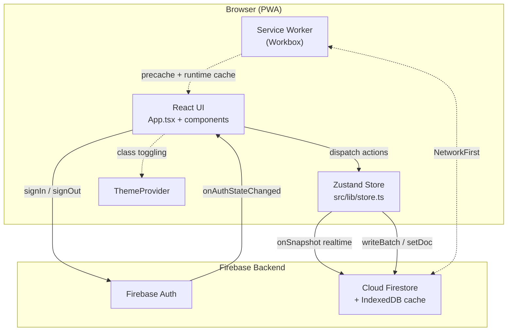
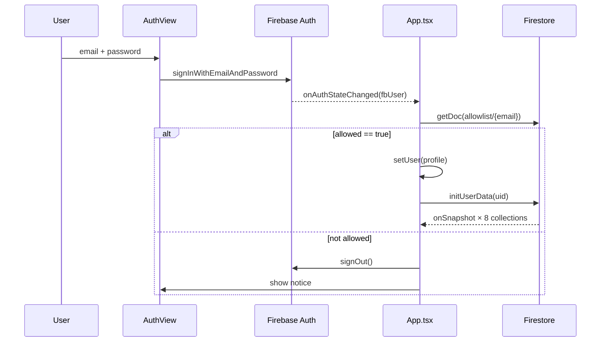
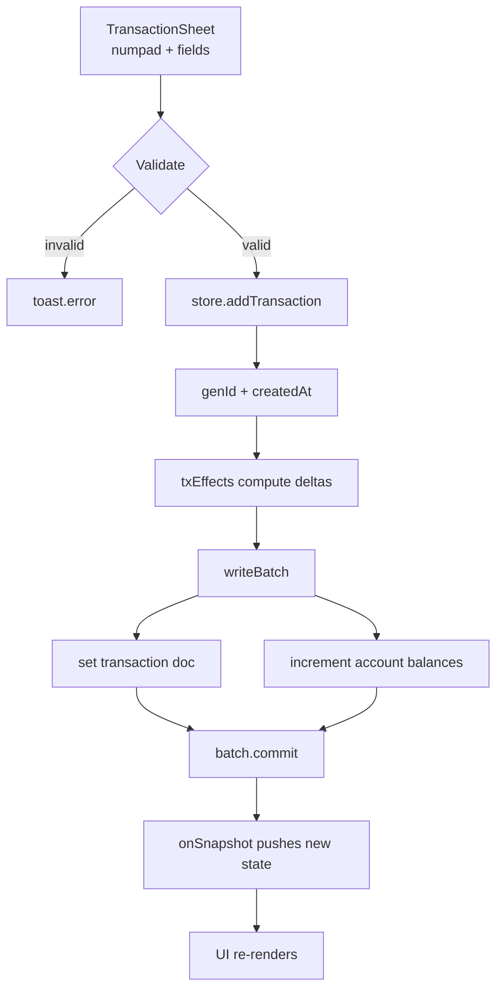
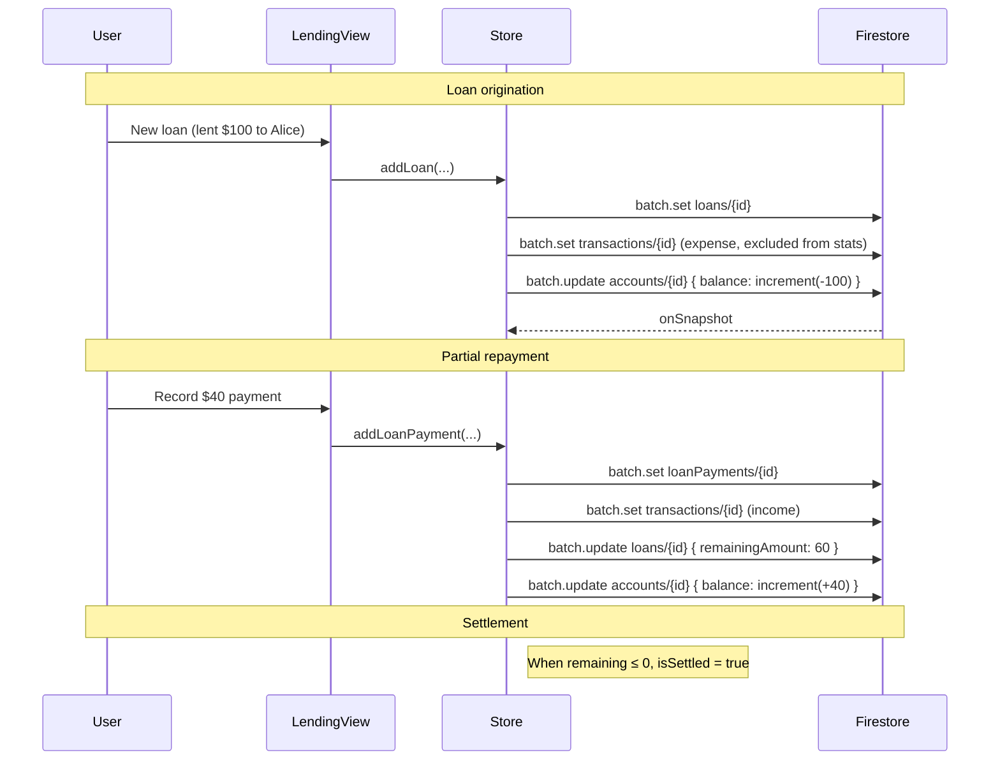
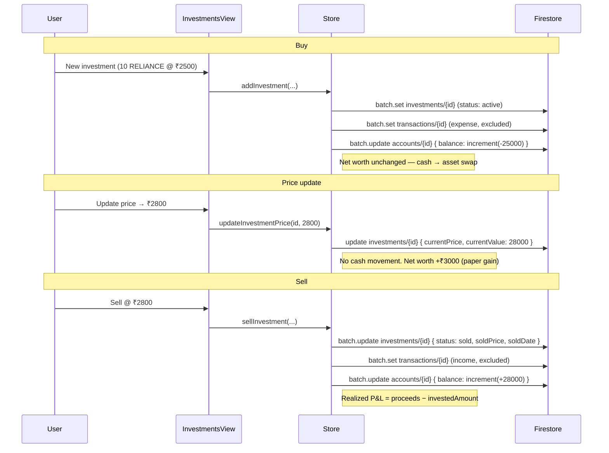
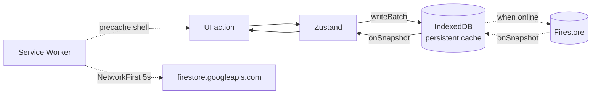
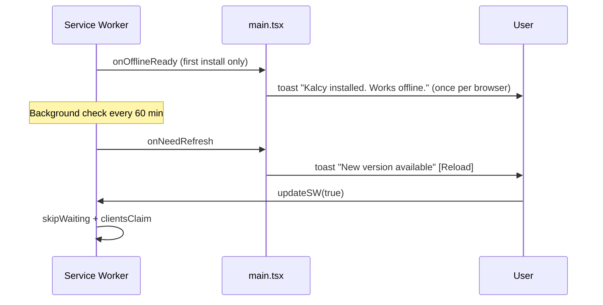
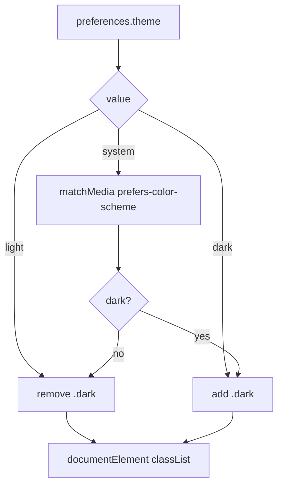
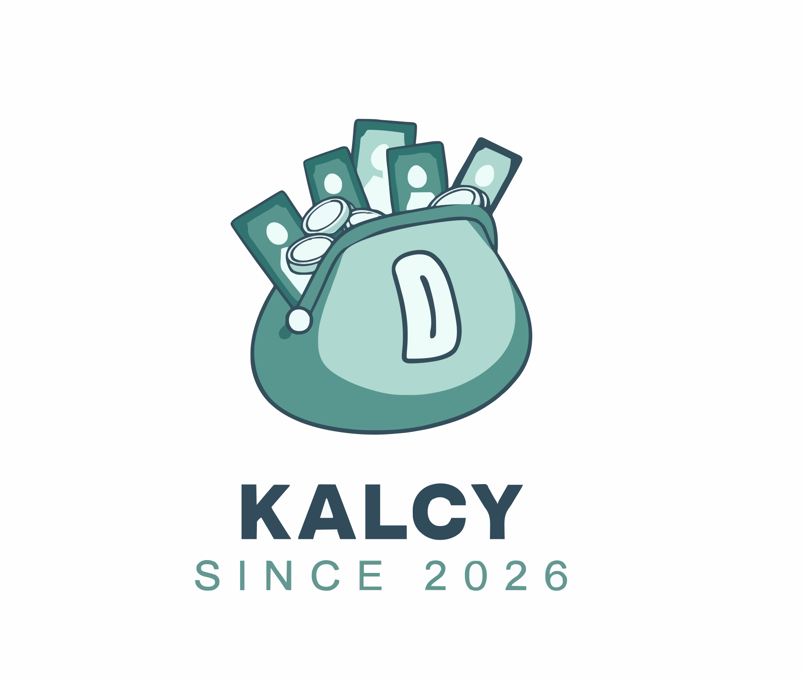

# Kalcy 💰

[](LICENSE)
[](http://makeapullrequest.com)

> A privacy-first, offline-capable personal finance PWA — track expenses, manage budgets, monitor accounts, track loans, and monitor your investment portfolio — all synced in real time through Firebase.

---

## Table of Contents

1. [Overview](#overview)
2. [Tech Stack](#tech-stack)
3. [Features](#features)
4. [High-Level Architecture](#high-level-architecture)
5. [Data Model](#data-model)
6. [Directory Structure](#directory-structure)
7. [Getting Started](#getting-started)
8. [Firestore Setup & Security Rules](#firestore-setup--security-rules)
9. [Core Workflows](#core-workflows)
10. [State Management](#state-management)
11. [Design System](#design-system)
12. [PWA & Offline Strategy](#pwa--offline-strategy)
13. [Scripts](#scripts)
14. [Conventions & Notes](#conventions--notes)
15. [Known Limitations](#known-limitations)
16. [License](#license)

---

## Overview

**Kalcy** is a mobile-first, Progressive Web App (PWA) for personal finance. It is intentionally **invite-only** — an `allowlist` collection in Firestore gates access after email/password authentication.

It is built as a single-page React app that:

- Syncs all data to **Cloud Firestore** with **offline persistence enabled by default**
- Seeds sensible defaults (accounts, categories, budget templates) on first sign-in
- Handles **accounts, transactions, transfers, budgets, loans, and repayments** with correct double-entry-style balance updates
- Tracks an **investment portfolio** (shares, IPOs, mutual funds, ETFs, crypto, bonds, FDs, real estate, gold) with live P&L and net-worth integration
- Works **fully offline** once installed, and auto-updates in the background
- Ships as an installable PWA with maskable icons and a themed splash

The project deliberately avoids a backend server: Firestore + Firebase Auth are the entire "backend", and all business logic lives in a Zustand store that reconciles local state with real-time Firestore snapshots.

---

## Tech Stack

| Layer | Choice | Notes |
|---|---|---|
| Build | **Vite 5** | Fast HMR, ESM-native, `@` → `src` alias |
| UI | **React 18** + **TypeScript 5** | Strict mode, `noUnusedLocals`, `noUnusedParameters` |
| Styling | **Tailwind CSS 3** + **shadcn/ui** (Radix) | CSS-variable theming, light/dark |
| Animation | **Framer Motion 11** | Layout pills, sheet transitions, swipe gestures |
| State | **Zustand 4** | Single store, no boilerplate |
| Backend | **Firebase 10** (Auth + Firestore) | `persistentLocalCache`, `persistentMultipleTabManager` |
| Charts | **Recharts 2** | Pie, Bar, Line |
| Bottom sheets | **Vaul** | iOS-style drawers, `repositionInputs` for keyboard |
| Toasts | **Sonner** | Themed via `ThemeProvider` |
| Icons | **Lucide React** | Mapped by string name in `icon-map.tsx` |
| PWA | **vite-plugin-pwa** + **Workbox 7** | `autoUpdate`, runtime caching, precache |
| Assets | **@vite-pwa/assets-generator** | Generates maskable/apple icons from `kalcy-logo.svg` |

---

## Features

### 🔐 Authentication & Access Control
- Email/password sign-in via Firebase Auth
- **Allowlist enforcement** — only `allowlist/{email}` with `enabled: true` may use the app
- Profile drawer for display name + password change (requires re-authentication)

### 💸 Transactions
- Three types: **expense**, **income**, **transfer**
- Built-in **calculator numpad** (supports `+ − × ÷`, AC, backspace)
- Hierarchical categories (parent → sub-categories)
- Date + time picker with quick presets (Today / Yesterday / 2 days ago)
- Notes, "exclude from stats", "exclude from budget" switches
- Swipe left to delete, swipe right to edit
- Four view modes: **Daily**, **Calendar**, **Monthly**, **Summary**

### 🏦 Accounts
- Types: cash, bank, card, savings, wallet
- Editable icon (Lucide) + color
- Toggle "include in net worth total"
- **Transfers** between accounts
- Automatic balance reconciliation from transaction deltas

### 🎯 Budgets
- Monthly budgets — **overall** or **per category**
- Sub-category roll-up (parent budget includes children)
- Warning (≥80%) and over-budget states
- Carry-over flag (data model ready)

### 🤝 Lending
- Track money **lent** (asset) or **borrowed** (liability)
- Each loan generates a mirrored account transaction automatically
- Partial repayments with payment history
- Auto-settle when `remainingAmount ≤ 0`
- Net worth = accounts balance + net loan position

### 📈 Investments
- Track **shares, IPOs, mutual funds, ETFs, crypto, bonds, fixed deposits, real estate, gold** and custom types
- Per-unit **buy price** and **current market price** (user-updated)
- Automatic **unrealized P&L** (on active positions) and **realized P&L** (on sold positions)
- Every buy/sell creates a mirrored, stats/budget-excluded account transaction
- Portfolio **allocation breakdown** by asset type
- **Net worth contribution** = market value of all active positions
- Sale flow: marks the position `sold`, records proceeds, credits the funding account
- Example: buy 10 shares of `RELIANCE` @ ₹2,500 → cash drops ₹25,000, net worth unchanged. Price rises to ₹2,800 → net worth **+₹3,000**. Sell at ₹2,800 → cash rises, realized P&L **+₹3,000**.

### 📊 Statistics
- Monthly donut chart of category breakdown (expense / income toggle)
- 6-month income vs expense bar chart
- Cash-flow line chart
- Category progress bars with % of total

### ⚙️ Preferences
- 20 fiat currencies with symbol lookup
- Light / Dark / System theme
- Week start day (Mon / Sun)

### ☁️ Data
- **CSV export** of all transactions (formula-injection safe)
- **Delete All Data** (clears everything except the preferences marker so re-seeding doesn't trigger)

---

## High-Level Architecture



**Key idea:** the UI never talks to Firestore directly. It dispatches intent to `useStore`, which:

1. Computes side effects locally (e.g. account balance deltas, invested amounts)
2. Commits them in a single atomic `writeBatch`
3. Lets Firestore's real-time listeners push the canonical state back into the store

This means **every UI surface is driven by the store snapshot**, and the store is never optimistically out of sync for longer than a round-trip.

---

## Data Model

All user data is scoped under `users/{uid}/…`. Types live in `src/lib/types.ts`.

```mermaid
erDiagram
    ALLOWLIST {
        string email PK
        bool   enabled
    }

    USER ||--o{ ACCOUNT : owns
    USER ||--o{ CATEGORY : owns
    USER ||--o{ TRANSACTION : owns
    USER ||--o{ BUDGET : owns
    USER ||--o{ LOAN : owns
    USER ||--o{ LOAN_PAYMENT : owns
    USER ||--o{ INVESTMENT : owns
    USER ||--|| PREFERENCES : has

    ACCOUNT {
        string id
        string name
        enum   type "cash|bank|card|savings|wallet"
        number balance
        number initialBalance
        string currency
        string icon
        string color
        bool   isIncludedInTotal
        number createdAt
    }

    CATEGORY {
        string id
        string name
        enum   type "expense|income|transfer"
        string icon
        string color
        string parentId "nullable"
        bool   isHidden
        number order
    }

    TRANSACTION {
        string id
        enum   type "expense|income|transfer"
        number amount
        string accountId
        string toAccountId "nullable"
        string categoryId "nullable"
        number date
        string note
        bool   isExcludedFromStats
        bool   isExcludedFromBudget
        string linkedLoanId "nullable"
        string linkedPaymentId "nullable"
    }

    BUDGET {
        string id
        string categoryId "null = overall"
        number amount
        string period "monthly"
        bool   carryOver
        string monthYear "YYYY-MM"
    }

    LOAN {
        string id
        string personName
        enum   type "lent|borrowed"
        number principalAmount
        number remainingAmount
        string accountId
        number date
        number dueDate "nullable"
        bool   isSettled
    }

    LOAN_PAYMENT {
        string id
        string loanId
        number amount
        string accountId
        number date
    }

    INVESTMENT {
        string id
        string name
        string symbol
        enum   type "stocks|ipo|mutual_fund|etf|crypto|bond|fixed_deposit|real_estate|gold|other"
        number units
        number buyPrice
        number currentPrice
        number investedAmount "units * buyPrice"
        number currentValue   "units * currentPrice"
        string accountId
        number date
        number soldDate "nullable"
        number soldPrice "nullable"
        enum   status "active|sold"
        string linkedTransactionId "nullable"
        string linkedSellTransactionId "nullable"
    }

    PREFERENCES {
        string currency
        string currencySymbol
        enum   theme "light|dark|system"
        number weekStartDay "0|1"
        number monthlyStartDay
    }
```



### Firestore paths

```
allowlist/{email}                          ← top-level gate
users/{uid}/accounts/{accountId}
users/{uid}/categories/{categoryId}
users/{uid}/transactions/{transactionId}
users/{uid}/budgets/{budgetId}
users/{uid}/loans/{loanId}
users/{uid}/loanPayments/{paymentId}
users/{uid}/investments/{investmentId}
users/{uid}/profile/preferences            ← singleton doc, also used as seed marker
```

### Transaction ↔ Account effects

The helper `txEffects()` in `store.ts` produces the balance deltas for any transaction:

| Type | Effect on `accountId` | Effect on `toAccountId` |
|---|---|---|
| `expense` | `−amount` | — |
| `income` | `+amount` | — |
| `transfer` | `−amount` | `+amount` |

These deltas are always applied with `increment(delta)` inside a `writeBatch`, guaranteeing consistency even under concurrent edits.

Loan and investment transactions are **generated by the store** — they use the same `txEffects` path, so all balance arithmetic stays in one place.

---

## Directory Structure

```
.
├── dev-dist/                       # Dev-mode service worker (generated)
│   ├── sw.js
│   └── workbox-d488705a.js
├── public/
│   ├── kalcy-logo.svg              # Source asset for PWA generation
│   ├── favicon.ico
│   ├── apple-touch-icon-180x180.png
│   ├── maskable-icon-512x512.png
│   ├── pwa-64x64.png
│   ├── pwa-192x192.png
│   └── pwa-512x512.png
├── src/
│   ├── components/
│   │   ├── tabs/
│   │   │   ├── accounts-tab.tsx        # Accounts + Transfers + Lending + Investments segments
│   │   │   ├── budgets-view.tsx        # Monthly budgets CRUD
│   │   │   ├── lending-view.tsx        # Loans & repayments
│   │   │   ├── investments-view.tsx    # Investment portfolio (shares, IPO, crypto, …)
│   │   │   ├── stats-tab.tsx           # Recharts dashboards
│   │   │   └── transactions-tab.tsx    # Daily/Calendar/Monthly/Summary
│   │   ├── ui/                         # shadcn primitives
│   │   │   ├── button.tsx
│   │   │   ├── dialog.tsx
│   │   │   ├── drawer.tsx              # Vaul wrapper
│   │   │   ├── input.tsx
│   │   │   ├── label.tsx
│   │   │   ├── sonner.tsx
│   │   │   ├── switch.tsx
│   │   │   └── textarea.tsx
│   │   ├── auth-view.tsx               # Sign-in screen
│   │   ├── bottom-nav.tsx              # Tab bar + FAB
│   │   ├── calculator-numpad.tsx       # Arithmetic numpad
│   │   ├── icon-map.tsx                # String → Lucide component registry
│   │   ├── profile-edit-drawer.tsx     # Name + password change
│   │   ├── theme-provider.tsx          # light/dark/system
│   │   ├── transaction-item.tsx        # Swipeable row
│   │   └── transaction-sheet.tsx       # Multi-step add/edit sheet
│   ├── lib/
│   │   ├── currencies.ts               # 20 currencies + format helpers
│   │   ├── finance.ts                  # Pure aggregation/derivation helpers
│   │   ├── firebase.ts                 # App + Auth + Firestore (offline cache)
│   │   ├── seed-data.ts                # Default categories/accounts/budgets
│   │   ├── store.ts                    # Zustand store — the "brain"
│   │   ├── types.ts                    # All TypeScript domain types
│   │   └── utils.ts                    # cn() — clsx + tailwind-merge
│   ├── App.tsx                          # Root shell + auth gate + "More" tab
│   ├── index.css                        # Tailwind layers + theme tokens
│   ├── main.tsx                         # SW registration + render
│   └── vite-env.d.ts                    # Env var + PWA client typings
├── components.json                 # shadcn CLI config
├── index.html                      # PWA meta, theme-color, manifest hints
├── package.json
├── postcss.config.js
├── pwa-assets.config.ts            # Icon generation preset
├── tailwind.config.ts
├── tsconfig.json
└── vite.config.ts                  # VitePWA manifest + Workbox runtime caching
```

---

## Getting Started

### Prerequisites

- Node.js **18+**
- A Firebase project with **Email/Password** auth enabled
- A **Firestore** database (Native mode)

### 1. Install

```bash
npm install
```

### 2. Configure environment

Create a `.env` file at the repo root:

```env
VITE_FIREBASE_API_KEY=...
VITE_FIREBASE_AUTH_DOMAIN=your-project.firebaseapp.com
VITE_FIREBASE_PROJECT_ID=your-project
VITE_FIREBASE_STORAGE_BUCKET=your-project.appspot.com
VITE_FIREBASE_MESSAGING_SENDER_ID=...
VITE_FIREBASE_APP_ID=...
```

These are consumed by `src/lib/firebase.ts` via `import.meta.env`.

### 3. Seed the allowlist

Sign-in is gated. Manually create at least one doc in Firestore:

```
Collection: allowlist
Document ID: user@example.com          ← lowercase email
Field:       enabled (boolean) = true
```

Then create the user via Firebase Console → Authentication → Users.

### 4. Run

```bash
npm run dev
```

Open the printed `localhost` URL. The first sign-in seeds default categories and two starter accounts.

### 5. Regenerate PWA icons (optional)

```bash
npm run generate-pwa-assets
```

Reads `pwa-assets.config.ts` and produces maskable + apple + standard icons from `public/kalcy-logo.svg`.

---

## Firestore Setup & Security Rules

Kalcy expects **all per-user data to be scoped under `users/{uid}`** and the allowlist to be readable by the authenticated user matching that email. A minimal starting ruleset:

```javascript
rules_version = '2';
service cloud.firestore {
  match /databases/{database}/documents {

    // Allowlist: authenticated user may only read their own gate doc
    match /allowlist/{email} {
      allow read: if request.auth != null
                  && request.auth.token.email.lower() == email;
      allow write: if false;   // manage via Console / Admin SDK only
    }

    // Per-user data: only the owner
    match /users/{uid}/{document=**} {
      allow read, write: if request.auth != null && request.auth.uid == uid;
    }
  }
}
```

> ⚠️ **Important:** the app calls `getDoc(doc(db, 'allowlist', email))` on every auth state change. If your rules block this read, the user will be signed out with "Could not verify access."

---

## Core Workflows

### 1. Authentication + Allowlist Gate



**Notes:**
- `allowlist` check happens **after** Firebase Auth succeeds, not before — so a failed gate still produces a sign-out.
- `initUserData` first checks for `users/{uid}/profile/preferences`. If missing, it **seeds defaults in a single batch** (categories, accounts, preferences).
- Then it attaches **eight** `onSnapshot` listeners (accounts, categories, transactions, budgets, loans, loanPayments, **investments**, preferences). Any change anywhere in Firestore updates the store in place.

### 2. Adding a Transaction



`updateTransaction` reverses the **old** effects and applies the **new** ones — the net delta is always committed atomically:

```ts
const net = new Map<string, number>();
oldEffects.forEach((v, k) => net.set(k, (net.get(k) ?? 0) - v));
newEffects.forEach((v, k) => net.set(k, (net.get(k) ?? 0) + v));
```

### 3. Lending — Loan Lifecycle



**Rules encoded in the store:**
- Lending money out: `expense` on the account, **excluded from stats and budget** (it's not consumption — it's a receivable).
- Borrowing: `income`, also excluded.
- Repayment in the opposite direction.
- `updateLoan` re-syncs the initial transaction's `amount`, `accountId`, and `date` when the user edits the loan, applying signed deltas per account.
- `deleteLoan` cascades: deletes the loan, every `linkedLoanId` transaction, and every payment.

### 4. Investments — Buy / Update / Sell Lifecycle



**Rules encoded in the store:**
- Buying moves cash → asset; both sides are excluded from stats and budget so analytics stay clean.
- **Price updates never touch cash.** Only `currentPrice` / `currentValue` change, which moves the paper net worth.
- Selling flips the position to `sold`, records `soldPrice` / `soldDate`, and credits the funding account.
- `deleteInvestment` reverses both its buy and (if any) sell transactions and restores cash. Sold or active — both paths are handled.
- The `accountId` is used symmetrically: **funds the buy** and **receives the sell proceeds**, mirroring the loan model.

### 5. Deleting an Account (Cascade)

`deleteAccount` is the most complex operation. It:

1. Identifies loans whose **home account** is the deleted one → marks them for deletion.
2. Identifies payments routed through the account → marks them for deletion.
3. Identifies investments funded by the account → marks them (and their linked buy/sell transactions) for deletion.
4. Collects every transaction that references any of:
   - the account itself (`accountId` or `toAccountId`)
   - a deleted loan (`linkedLoanId`)
   - a deleted payment (`linkedPaymentId`)
   - a deleted investment (`linkedTransactionId` / `linkedSellTransactionId`)
5. **Reverses** each collected transaction's effects on **surviving** accounts.
6. **Restores** `remainingAmount` on loans whose *payment* is being removed but whose *loan* survives.
7. Deletes transactions, loans, payments, investments, and finally the account — all in one `writeBatch`.

### 6. Offline-First Sync



- **Firestore SDK** is initialized with `persistentLocalCache({ tabManager: persistentMultipleTabManager() })`, so writes go to IndexedDB first and sync when connectivity returns. Snapshots still fire from cache while offline.
- **Workbox** adds a layer of HTTP caching on top:
  - `NetworkFirst` for `firestore.googleapis.com` — 5s timeout, 100 entries / 24h expiry
  - `CacheFirst` for `fonts.gstatic.com` — 30 entries / 1 year
- An online/offline banner in the **More** tab reflects `navigator.onLine` (polled every 5s as a Safari fallback).

### 7. PWA Update Lifecycle



- `registerType: 'autoUpdate'` means a new SW is installed silently.
- The `onOfflineReady` toast is deduplicated with a `localStorage` key (`kalcy.offlineReadySeen`) so it doesn't nag.
- `clientsClaim()` + `self.skipWaiting()` activate the new worker immediately.

### 8. Theme Resolution



`ThemeProvider` reads `preferences.theme` from the store and applies the `dark` class to `<html>`. When `system` is selected, it subscribes to `matchMedia` and re-applies on change.

---

## State Management

`useStore` (Zustand) is the single source of truth for the running app.

```mermaid
graph TD
    subgraph Store["useStore (Zustand)"]
        D[Data slices:<br/>accounts, categories, transactions,<br/>budgets, loans, loanPayments,<br/>investments, preferences]
        A[Actions:<br/>CRUD for each slice + auth]
    end

    App[React Components] -->|useStore(s => s.x)| D
    App -->|useStore(s => s.action)| A
    A -->|writeBatch| FS[(Firestore)]
    FS -->|onSnapshot| D
```

**Guiding principles:**

- **No optimistic local mutation** — the store only writes to Firestore; Firestore pushes the truth back via `onSnapshot`.
- **Every multi-doc write is a `writeBatch`** — no partial state.
- **Balance changes always use `increment()`**, never absolute values, so concurrent edits from multiple tabs can't clobber each other.
- **Derived values are pure functions** in `src/lib/finance.ts` (e.g. `getMonthlyTotals`, `getBudgetProgress`, `getLoansSummary`, `getInvestmentsSummary`, `getInvestmentPnl`, `getTotalNetWorth`) — they never touch Firestore, they just consume the current arrays.
- **Loan transactions are linked** via `linkedLoanId` (the parent loan) and `linkedPaymentId` (the specific repayment). Investment transactions are linked via `linkedTransactionId` (buy) and `linkedSellTransactionId` (sell). This makes cascading deletes deterministic.
- **Denormalized values are recomputed on write.** `investedAmount` (`units × buyPrice`) and `currentValue` (`units × currentPrice`) are always recomputed inside the store when the underlying units or prices change — so list rendering and sum-based analytics never need to re-derive them.

### Listener teardown

```ts
// setUser(null) or sign-out:
clearUnsubs();         // unsubscribes all 8 onSnapshot listeners
clearLocalState();     // wipes arrays + resets preferences to DEFAULT
```

---

## Design System

Themes are driven by CSS variables in `src/index.css`, consumed by Tailwind via `hsl(var(--token))`.

| Token | Light | Dark | Use |
|---|---|---|---|
| `--primary` | `158 64% 42%` (teal) | `158 64% 52%` | Brand, FAB, active nav |
| `--expense` | `0 76% 60%` (red) | `0 72% 55%` | Negative amounts |
| `--income` | `142 71% 45%` (green) | `142 71% 50%` | Positive amounts |
| `--transfer` | `212 92% 55%` (blue) | `212 92% 60%` | Transfers |
| `--warning` | `38 92% 50%` (amber) | `38 92% 55%` | Budget ≥ 80% |
| `--radius` | `1.25rem` | same | Very round UI |

**UI vocabulary:**
- Bottom sheets (Vaul) for all data entry — never modal forms on mobile
- Rounded-3xl cards with `border-border/40` hairlines
- Gradient hero cards (`from-primary to-primary/70`) for balance/budget/net-worth/portfolio headers
- Layout-animated nav pill (`layoutId="nav-pill"`) for tab transitions
- Lucide icons resolved by **string name** through `icon-map.tsx`, so Firestore can store `icon: "UtensilsCrossed"` and the UI finds the component
- Investment types share the same icon registry — `INVESTMENT_TYPES` in `icon-map.tsx` maps each type to `{ label, icon, color }` for consistent rendering across cards, charts, and pickers

---

## PWA & Offline Strategy

Configured in `vite.config.ts`:

```ts
VitePWA({
  registerType: 'autoUpdate',
  manifest: {
    name: 'Kalcy',
    display: 'standalone',
    orientation: 'portrait',
    theme_color: '#3f7a6f',
    background_color: '#ffffff',
    icons: [/* 64, 192, 512, maskable 512 */],
  },
  workbox: {
    globPatterns: ['**/*.{js,css,html,svg,png,ico,woff2}'],
    navigateFallback: '/index.html',
    navigateFallbackDenylist: [/^\/__/],
    runtimeCaching: [
      { urlPattern: firestore, handler: 'NetworkFirst', timeout: 5 },
      { urlPattern: fonts.gstatic, handler: 'CacheFirst', maxAge: 1y },
    ],
  },
  devOptions: { enabled: true, type: 'module' },
})
```

**Layered caching:**

| Layer | What it caches | TTL / Limit |
|---|---|---|
| Precache (Workbox) | App shell (JS/CSS/HTML/SVG/PNG/ICO/WOFF2) | Versioned by build hash |
| Runtime — Firestore REST | GET responses from `firestore.googleapis.com` | 100 entries / 24h, NetworkFirst 5s |
| Runtime — Fonts | `fonts.gstatic.com` assets | 30 entries / 1y |
| Firestore SDK (IndexedDB) | All Firestore reads/writes | Persistent, multi-tab |

The SDK-level persistence is what makes the app **truly offline-capable** — Workbox's runtime cache is a safety net for the REST layer the SDK sometimes uses.

---

## Scripts

| Command | What it does |
|---|---|
| `npm run dev` | Start Vite dev server (SW enabled in dev) |
| `npm run build` | Type-check (`tsc`) then produce a production build |
| `npm run preview` | Serve the production build locally |
| `npm run generate-pwa-assets` | Regenerate maskable / apple / PWA icons from the SVG |

---

## Conventions & Notes

- **Path alias:** `@/*` → `src/*` (both in `vite.config.ts` and `tsconfig.json`).
- **No `any` leaking into components:** Firestore listener callbacks narrow doc data to the domain types in `types.ts`.
- **CSV safety:** `csvSafe()` prefixes formula-injection starters (`= + - @` and tabs) with `'`.
- **Date handling:** all timestamps are stored as `number` (epoch ms). `formatDateKey` / `parseLocalDate` exist specifically to avoid the UTC shift from `new Date('YYYY-MM-DD')`.
- **Loan exclusion:** all auto-generated loan transactions carry `isExcludedFromStats: true` and `isExcludedFromBudget: true` so they don't distort spending analytics or budgets.
- **Investment exclusion:** same policy — buys and sells are balance-sheet moves, not consumption. They appear in the transaction list but are filtered out of stats and budgets.
- **Denormalization discipline:** `investedAmount` and `currentValue` on `Investment` are recomputed by `addInvestment`, `updateInvestment`, `updateInvestmentPrice`, and `sellInvestment` — never written by the UI directly.
- **Net worth formula:**

  ```
  netWorth = Σ(accounts where isIncludedInTotal).balance
           + Σ(loans active).remainingAmount (lent − borrowed)
           + Σ(investments active).currentValue
  ```

  Buying an investment swaps cash for an asset, so it is **net-worth neutral at purchase time**. Only price appreciation/depreciation and realized P&L move the needle.
- **Form remounting:** `TransactionSheet`, `LoanSheet`, `AccountSheet`, `BudgetSheet`, and the investment sheets all remount their inner form on open (`key={open ? id : 'closed'}`) so local state never goes stale between openings.

---

## Known Limitations

- **Invite-only by design.** There is no sign-up UI; users must be created manually in Firebase Console and added to `allowlist`.
- **Carry-over budgets** are stored but not yet applied in `getBudgetProgress` — the flag is forward-compatible.
- **Recurring transactions** are not implemented (categories include a `Repeat` icon, but no scheduler exists).
- **Multi-currency conversion** is not supported — one currency per user (set in Preferences); account-level currency field exists but is informational.
- **Receipt uploads** (`receiptUrl`) are typed and stored but there is no upload UI yet.
- **`monthlyStartDay` preference** is stored but the aggregation currently uses calendar months.
- **Investment prices are manual.** There is no market-data feed yet — you update `currentPrice` per position. A future version could add a scheduled cloud function that fetches quotes from a provider (Alpha Vantage, Yahoo Finance, etc.) and calls `updateInvestmentPrice`.
- **Investment quantities cannot be split.** Selling always sells the full position. Partial sells would require splitting the record into "sold lot" + "remaining position" (or tracking lots) — deliberately out of scope for v1.
- **Workbox `dev-dist/`** is a generated artifact — regenerated on `npm run dev`. Don't edit it directly.

---

## License

This project is **open source** and released under the [MIT License](LICENSE).

You are free to use, copy, modify, merge, publish, distribute, sublicense, and/or sell copies of the software — as long as the original copyright notice and permission notice are included in all copies or substantial portions of the software.

See the [`LICENSE`](LICENSE) file for the full text.

---

<p align="center">
  
  <br/>
  <em>Track it. Budget it. Invest it. Own it.</em>
</p>